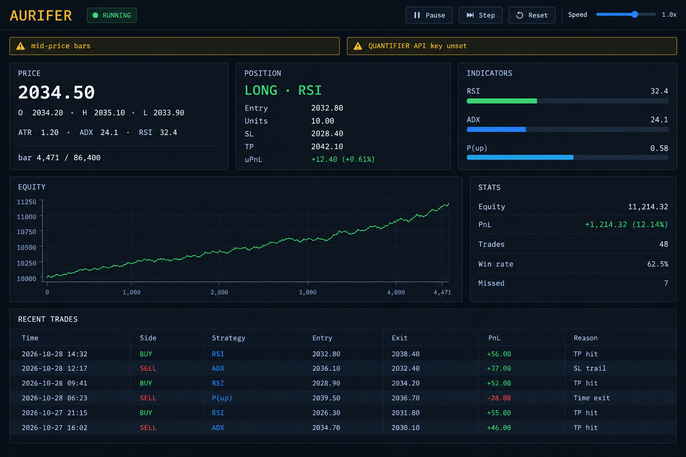

# Aurifer

[](https://opensource.org/licenses/MIT)
[](https://www.rust-lang.org/)

**A scientific instrument for gold (XAU/USD) trading strategies. It tells you when not to trade.**

Aurifer is a Rust research system for backtesting short-term gold strategies against real market data. It runs five strategy families, trains a calibrated ML predictor, walk-forward validates the predictor against regime shifts, and reports statistical significance on every backtest. When the math doesn't hold, it says so — and refuses to trade.



It talks to **IG Markets** for both historical data and live execution (via the `ig-client` crate). It is not a money machine. It is the tool you build *before* you have a strategy, so you can find out — with real data and realistic costs — whether the strategy is worth risking money on.

---

## What it does

- **Backtests** against real 1-minute XAU/USD data from IG Markets
- **Runs five strategy families**: RSI mean-reversion, Donchian breakout, squeeze release, order-flow proxy, and a calibrated ML predictor
- **Walk-forward validates** the predictor across multiple folds and market regimes, and **auto-disables it** when the edge doesn't survive
- **Simulates realistically**: next-bar-open fills, session/vol/size-aware spread, sqrt-scaled slippage, per-trade commissions
- **Manages risk mechanically**: ATR-based stops, continuous trailing, partial exits, wall-clock time stops, daily loss halts, news blackout windows
- **Reports statistical significance**: Wilson CIs on win rate, bootstrap CIs on PnL and Sharpe, break-even win rate computed from actual RR
- **Places real orders on IG** — demo by default, live only after an explicit opt-in
- **Ships two dashboards**: an interactive terminal UI (TUI) and a browser dashboard (Web UI)

## What it does not do

- **Predict exact prices.** The predictor outputs a probability of direction, not a point forecast. There is a diagnostic to prove why point prediction is untradeable — see [`diagnostics point-prediction`](#diagnostics).
- **Guarantee profit.** No system can. What exists is statistical edge — a >52% probability of winning on a defined set of trades. Aurifer measures it; it doesn't create it.
- **Run at institutional HFT speeds.** Retail brokers route through their own matching engines. Microsecond latency is not something you can code your way into from a VPS.
- **Use real footprint / order-flow data.** The order-flow family is a close-location proxy. True stacked-imbalance data requires a paid feed (Databento, CQG) that isn't wired in.
- **Give you deep history from IG.** IG caps a single historical request at ~1000 bars for minute data. For multi-year 1-minute backtests you need a separate historical source (Databento, Polygon). See [Limitations](#limitations).

---

## Quick start

```bash
# Build
cargo build --release

# Configure IG credentials
cp .env.example .env
# edit .env with your IG_USERNAME, IG_PASSWORD, IG_API_KEY, IG_ACCOUNT_ID

# Interactive terminal dashboard (default command)
./target/release/aurifer

# Browser dashboard — opens automatically at http://localhost:<port>
./target/release/aurifer web

# Headless backtest with full statistical report
./target/release/aurifer backtest --start 2024-01-01 --end 2024-03-01
```

The compiled `target/release/aurifer` binary is **fully self-contained** — HTML, CSS, and JS are embedded at compile time. Copy it anywhere, run it from any directory, on any machine.

If `.env` is missing or IG credentials are wrong, Aurifer prints a warning and **falls back to synthetic data** so you can still exercise the pipeline. Synthetic backtest numbers are meaningless — they exist only to prove the code runs.

---

## Installation

### From source

```bash
git clone https://github.com/<you>/aurifer.git
cd aurifer
cargo build --release
cp target/release/aurifer /usr/local/bin/
```

Requires **Rust 1.80+**. Nothing else. No Python, Node, or system libraries beyond the OS defaults.

### Verify the build

```bash
aurifer --version
aurifer --help
```

---

## Configuration

Aurifer reads IG credentials from environment variables (loaded from `.env` by `dotenvy`).

### `.env` file

```dotenv
# Required — IG demo account credentials
IG_USERNAME=your_ig_username
IG_PASSWORD=your_ig_password
IG_API_KEY=your_api_key
IG_ACCOUNT_ID=your_account_id

# Optional — demo (default) or live
# Demo:   https://demo-api.ig.com/gateway/deal
# Live:   https://api.ig.com/gateway/deal
IG_BASE_URL=https://demo-api.ig.com/gateway/deal

# Optional — the specific gold CFD epic on your IG account.
# Use `aurifer ig-search gold` (or the search helper in broker.rs) to find yours.
# Common: CS.D.CFDGOLD.CFDGC.IP (spot gold CFD, 100 oz)
IG_GOLD_EPIC=CS.D.CFDGOLD.CFDGC.IP

# Optional — order size in IG "size" units (1.0 = 1 contract for the epic)
IG_ORDER_SIZE=1.0

# Optional — news calendar blackout windows
QUANTGIST_API_KEY=your_quantgist_key
```

### Finding your gold epic

IG assigns epics per account type. Before trusting the default, verify yours:

```rust
// src/broker.rs exposes:
let results = broker.search("gold").await?;
for (epic, name) in results {
    println!("{epic}  {name}");
}
```

Put the epic you want into `IG_GOLD_EPIC`. The default (`CS.D.CFDGOLD.CFDGC.IP`) is the 100 oz spot gold CFD for most accounts — but not all.

### Key config knobs

All parameters live in `Config` in `src/types.rs`. The defaults are a reasonable starting hypothesis, not a validated edge.

**Risk:**

| Field | Default | Meaning |
|---|---|---|
| `initial_equity` | `10_000.0` | Starting account balance |
| `risk_per_trade` | `0.005` | 0.5% of equity at risk per trade |
| `daily_loss_limit` | `0.02` | Halt for the day at 2% drawdown |
| `max_trades_per_day` | `8` | Prevent overtrading during chop |

**Exits:**

| Field | Default | Meaning |
|---|---|---|
| `atr_sl_mult` | `1.5` | Stop-loss distance in ATR units |
| `atr_tp_mult` | `3.0` | Take-profit distance (1:2 RR) |
| `trail_after_atr` | `1.0` | Move SL to breakeven after +1×ATR |
| `trail_atr_mult` | `1.0` | Trail 1×ATR behind the running extreme |
| `partial_atr_mult` | `1.5` | Take 50% profit at +1.5×ATR |
| `max_seconds_in_trade` | `1800` | Force-close after 30 minutes wall clock |

**Costs (IG-specific defaults):**

| Field | Default | Meaning |
|---|---|---|
| `spread` | `0.30` | IG spot gold typical spread in USD |
| `max_spread` | `0.35` | Session+vol multiplier cap |
| `slippage` | `0.05` | Base per-fill slippage (scales with size) |
| `commission_per_unit` | `0.0` | IG charges via spread on CFDs — no separate commission |

**Strategy:**

| Field | Default | Meaning |
|---|---|---|
| `rsi_low` / `rsi_high` | `30` / `70` | RSI reversal thresholds (uses cross, not level) |
| `adx_min` | `20` | Minimum ADX for breakout/RSI signals |
| `donchian_period` | `10` | Breakout lookback window |
| `bb_period` / `kc_period` | `20` / `20` | Squeeze detection |
| `require_squeeze_gate` | `false` | Only trade during squeeze releases |
| `require_orderflow_confirm` | `false` | Require order-flow agreement |

To change defaults, edit `impl Default for Config` in `src/types.rs`.

---

## Usage

### Interactive TUI

```bash
aurifer                        # default command
aurifer tui --start 2024-01-01 --end 2024-06-30
```

Keyboard controls:

| Key | Action |
|---|---|
| `Space` | Pause / resume simulation |
| `S` | Step one bar (auto-pauses) |
| `+` / `=` | Speed up ×2 |
| `-` / `_` | Slow down ÷2 |
| `R` | Reset to the beginning |
| `Q` / `Esc` | Quit |

### Browser dashboard

```bash
aurifer web                    # opens browser automatically
aurifer web --no-open          # skips browser launch (SSH, CI, headless)
```

The dashboard shows a live equity curve, current position, indicator gauges, and a trade log. Controls mirror the TUI: pause, step, reset, speed slider.

### Headless backtest

```bash
aurifer backtest --start 2024-01-01 --end 2024-06-30
```

Prints:

```
───── BACKTEST RESULTS ─────
Trades:       312
Missed trades:  14
Win rate:     54.2%
Total PnL:    $1840.55
Final equity: $11840.55
Return:       18.41%

Realized adverse gap: 0.0421 (n=298)
Modeled slippage:     0.0500

───── STATISTICAL SIGNIFICANCE ─────
Sample size:  312
Win rate:     54.2%  (95% CI 48.6%–59.6%)
Break-even:   47.4%
Significant:  NO
Total PnL CI: [$-421.80, $4102.90]
Sharpe:       1.83  (95% CI -0.42–4.11)

───── WARNINGS ─────
⚠️ win rate 95% CI [48.6%, 59.6%] does not clear breakeven 47.4%
⚠️ 95% CI on total PnL crosses zero — results could be luck

🚫 DO NOT TRADE LIVE until significance warnings clear.
```

**If the report ends with "DO NOT TRADE LIVE", believe it.** The statistics are doing exactly what they're supposed to do — telling you when a result is indistinguishable from luck.

### Live trading (IG)

```bash
# 1. Create an IG demo account at https://www.ig.com/
# 2. Generate an API key: My IG → Settings → API Keys
# 3. Fill in .env with the credentials

# Demo (default — IG_BASE_URL points to demo-api)
aurifer live --confirm-live

# Real money — requires BOTH IG_BASE_URL to point to the live API AND --confirm-live
# Set IG_BASE_URL=https://api.ig.com/gateway/deal in .env, then:
aurifer live --confirm-live
```

**Before you point `IG_BASE_URL` at the live endpoint:**

1. Backtest on **3+ years** of data. If walk-forward validation fails, the predictor is auto-disabled — respect that.
2. Backtest on a **different calendar year** than training. If the second year also passes, the edge may be real.
3. Run in **demo for at least 3 months**. Compare demo results against the backtest over the same period. If demo loses money where the backtest was profitable, the backtest is wrong.
4. Check the **realized adverse gap** printed at the end of every run. If it's > 1.5× the modeled slippage, raise `Config::slippage` and re-run.

If any of those fail, the strategy does not have a tradeable edge. The correct response is more research — not more leverage.

### Diagnostics

```bash
aurifer diagnostics point-prediction --start 2024-01-01 --end 2024-03-31 --horizon 30
```

Trains a ridge regression to predict exact price `t+horizon` ahead, then shows:

- Mean absolute error, median error, RMSE
- % of predictions within half-spread, spread, and typical SL
- Actionable PnL if you traded every prediction above cost
- Sample predictions

**The output will say `❌ NOT TRADEABLE`.** This is intentional. The diagnostic exists to prove in numbers what is stated in prose: at 1-minute resolution, gold's noise is larger than any predictable signal. Average error will be 10–100× the spread. Do not trade on point predictions.

### Offline / CI mode

Every command accepts `--no-ig`. When set, Aurifer skips the IG connection and generates synthetic bars so you can exercise the pipeline without credentials:

```bash
aurifer backtest --no-ig
cargo test -- --test-threads=1
```

Synthetic backtest numbers are meaningless. This flag exists to keep CI fast and hermetic.

---

## Architecture

```
┌─────────────────────────────────────────────────────────────────┐
│  broker::IgBroker::fetch_bars  /  snapshot                     │
│  (ig-client 0.18 — REST, governor rate limiter)                │
└──────────────────────────────┬──────────────────────────────────┘
                               │ Vec<Bar>
                               ▼
┌─────────────────────────────────────────────────────────────────┐
│  SessionState::step(bar)                                        │
│  ┌────────────────────────────────────────────────────────────┐ │
│  │ 1. Execute pending signal at this bar's OPEN               │ │
│  │ 2. StrategyEngine::on_bar → 5 families → Eval              │ │
│  │ 3. If in position: manage SL/TP/trail/partial/time-stop    │ │
│  │ 4. Else: risk checks → queue next-bar signal if fired      │ │
│  └────────────────────────────────────────────────────────────┘ │
└──────────────────────────────┬──────────────────────────────────┘
                               │ SessionState (trades, equity)
              ┌────────────────┼────────────────┐
              ▼                ▼                ▼
        ┌──────────┐    ┌──────────┐    ┌──────────────┐
        │ TUI      │    │ Web      │    │ Report       │
        │ ratatui  │    │ axum+ws  │    │ + stats::    │
        │          │    │          │    │   analyze    │
        └──────────┘    └──────────┘    └──────────────┘
```

The predictor pipeline runs *before* the backtest:

```
warm up indicators over all bars
    → extract 15 causal features per bar
    → build labels (did price rise > 0.3×ATR over next 30 bars?)
    → walk-forward validate (4 expanding folds, per-regime breakdown)
    → if validation passes: train final calibrated model
    → if validation fails:    disable predictor, continue with rule-based only
```

The live loop is a **2-second REST poll** against IG's snapshot endpoint, aggregated into 1-minute bars, feeding the same `SessionState::step()`. If you want to swap polling for IG's Lightstreamer feed later, only `run_live_trading()` changes — the rest of the pipeline is identical.

---

## File structure

```
aurifer/
├── Cargo.toml
├── .env.example
├── Makefile
├── LICENSE
├── README.md
├── .gitignore
├── src/
│   ├── main.rs            Entry point, CLI dispatch, backtest orchestration
│   ├── cli.rs             clap CLI definitions
│   ├── types.rs           Core data structures
│   ├── indicators.rs      RSI, EMA, SMA, ATR, ADX, Bollinger, Keltner, Donchian
│   ├── strategies.rs      StrategyEngine — 5 families + confluence gates
│   ├── predictor.rs       Calibrated logistic regression + walk-forward
│   ├── point_predictor.rs Ridge regression diagnostic
│   ├── costs.rs           Session/vol/size-aware cost model
│   ├── data.rs            IG bars + synthetic fallback
│   ├── broker.rs          IG Markets client (ig-client 0.18)
│   ├── session.rs         Per-bar state machine
│   ├── stats.rs           Wilson CI, bootstrap PnL/Sharpe CI
│   ├── tui.rs             ratatui terminal dashboard
│   └── web.rs             axum server + WebSocket + embedded assets
└── static/
    ├── index.html         (embedded at compile time via include_str!)
    ├── style.css
    └── app.js
```

---

## Design principles

These are the non-negotiables behind every design decision in this codebase:

1. **No lookahead.** Features use only bars at or before `t`. Labels use `t + horizon` strictly. If backtest accuracy exceeds 65%, suspect a bug before celebrating.

2. **Next-bar-open fills.** Signals are computed at bar close. Fills happen at the next bar's open, with spread and slippage. Filling at signal-bar close is fantasy.

3. **Realistic costs.** Spread widens 2× during rollover, 1.6× during Asia, 2.5× in high-ATR regimes. Slippage scales with `sqrt(units / baseline)`. Modeled costs are a **floor**, not a realistic estimate.

4. **Statistics or it doesn't count.** Every backtest ends with Wilson CI on win rate, bootstrap CI on PnL and Sharpe, and break-even win rate. If any CI crosses zero or fails to clear break-even, the report says `DO NOT TRADE LIVE`.

5. **Predictors validate or die.** Walk-forward validation runs across 4 expanding folds and per-regime breakdowns. If aggregate AUC < 0.54, worst fold < 0.50, or fewer than 2 regimes show positive edge, the predictor is **auto-disabled**.

6. **One explicit opt-in for real money.** `--confirm-live` is required, and `IG_BASE_URL` must point at the live endpoint. Accidentally trading real money because of a typo is the exact failure mode this project is designed to prevent.

7. **The diagnostic exists to prove what doesn't work.** `point-prediction` isn't a feature — it's a proof. It shows, with the user's own data, why point prediction is untradeable.

---

## Limitations

| Limitation | Why | Workaround |
|---|---|---|
| **Shallow IG history** | IG caps a single historical request at ~1000 bars for minute data | Use Databento or Polygon for multi-year backtests; use IG only for live execution |
| **`snapshot_time` is UK local time** | IG does not return UTC on the REST endpoint | Bar ordering and indicators are unaffected; session filters will see a 0–1 hour offset |
| **Order confirmation is async** | `create_order` returns a deal reference, not a deal ID | Log the reference; wire `get_order_confirmation(deal_reference)` in a future version |
| **Polling, not streaming** | The live loop polls every 2 seconds | Replace `run_live_trading` with IG's Lightstreamer feed if you need true streaming |
| **No real footprint data** | Databento/CQG is a paid feed | `FootprintOrderFlow` trait stub is ready for a real implementation |
| **No retraining after startup** | Training happens once, up front | Retrain weekly in production via a v0.2 scheduler |
| **No unit tests** | Prioritized integration over unit coverage | Add `tests/` — see the file structure section |

---

## IG account notes

**Sign-up:** IG requires a live funded account to generate API keys for live endpoints. Demo keys are available but may require a support request. Open a demo account first at `ig.com` — you will be guided through KYC and an appropriateness questionnaire.

**Entity jurisdiction:** IG operates several regulated entities (IG Markets Ltd in the UK, IG US LLC, IG Australia, etc.). Your account's entity determines which epics you can trade. Use `search("gold")` after login to list the gold instruments available to you.

**API key generation:** Once your live account is verified, go to **My IG → Settings → API Keys → Generate New Key**. You will get an API key; use it with your IG username, password, and account ID in `.env`.

**Rate limits:** IG's API is rate-limited. `ig-client` paces requests via `governor`. The live loop's 2-second polling plus any historical fetches share the same budget. If you see `429` errors, raise the polling interval or reduce history fetches.

---

## Contributing

Issues and PRs welcome. Two ground rules:

1. **Anything that claims edge must be walk-forward validated.** If you add a new strategy family, add a walk-forward test for it — not a "backtest that looked good once."
2. **No lookahead. Ever.** Feature extraction happens strictly on data at or before `t`. If a PR removes that constraint, it will be rejected regardless of how good the results look.

For larger changes, open an issue first to discuss direction.

---

## License

MIT — see [LICENSE](LICENSE).

## Disclaimer

Aurifer is research software. It is not financial advice. Trading gold CFDs (or anything else) can result in losses exceeding your initial deposit. The MIT license disclaims all liability for any losses incurred through use of this software. Past backtest performance does not guarantee future results. CFD trading carries significant risk of loss and is not suitable for all investors. If you don't understand every line of this codebase, do not run `live` mode with real money.

**The "DO NOT TRADE LIVE" verdict printed by this program is not a bug. It is the point.**
```

---

## 📋 What changed vs. the OANDA version

| Section | Change |
|---|---|
| Header tagline | "XAU/USD" → same, but broker reference now IG |
| Quick start | Added `.env` setup; explained synthetic fallback |
| **New: Configuration section** | Full `.env` template, all `IG_*` variables documented, epic discovery workflow |
| Usage — live trading | IG-specific: demo vs live endpoint, `--confirm-live` only (no `OANDA_LIVE` env var) |
| Usage — offline mode | New `--no-ig` flag documented |
| Costs defaults | Updated to IG-specific values (`spread: 0.30`, `commission: 0.0`) |
| Architecture | IG client in the diagram; 2-second polling noted |
| File structure | `broker.rs` description now says "IG Markets client (ig-client 0.18)" |
| Design principles | Opt-in rule now references `--confirm-live` + live `IG_BASE_URL` |
| **New: Limitations section** | Explicit table of every IG-specific caveat |
| **New: IG account notes** | Sign-up, entity jurisdiction, API keys, rate limits |
| Disclaimer | Added "CFD trading carries significant risk of loss" |
