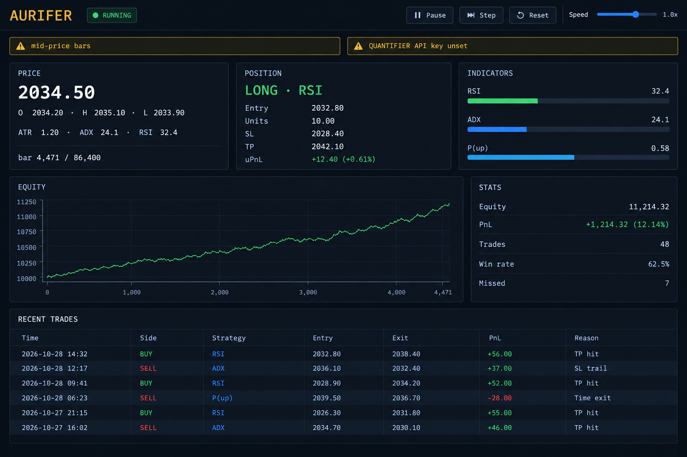

# Aurifer

[](https://opensource.org/licenses/MIT)
[](https://www.rust-lang.org/)

**A scientific instrument for gold (XAU/USD) trading strategies. It tells you when not to trade.**



Aurifer is a Rust research system for backtesting short-term gold strategies against real market data. It runs five strategy families, trains a calibrated ML predictor, walk-forward validates the predictor against regime shifts, and reports statistical significance on every backtest. When the math doesn't hold, it says so — and refuses to trade.

It fetches historical gold data from **xaus.com** — a free, keyless, JSON API with an explicit data-freshness contract. It is not a money machine. It is the tool you build *before* you have a strategy, so you can find out — with real data and realistic costs — whether the strategy is worth risking money on.

---

## What it does

- **Backtests** against real XAU/USD OHLCV data from xaus.com at MINUTE, HOUR, DAY, WEEK, or MONTH resolution
- **Runs five strategy families**: RSI mean-reversion, Donchian breakout, squeeze release, order-flow proxy, and a calibrated ML predictor
- **Walk-forward validates** the predictor across multiple folds and market regimes, and **auto-disables it** when the edge doesn't survive
- **Forecasts** a single probability — `aurifer forecast` fetches up to 10 years of history, trains, validates, and prints `P(up)` for the current bar
- **Simulates realistically**: next-bar-open fills, session/vol/size-aware spread, sqrt-scaled slippage, per-trade commissions
- **Manages risk mechanically**: ATR-based stops, continuous trailing, partial exits, wall-clock time stops, daily loss halts, news blackout windows
- **Reports statistical significance**: Wilson CIs on win rate, bootstrap CIs on PnL and Sharpe, break-even win rate computed from actual RR
- **Ships two dashboards**: an interactive terminal UI (TUI) and a browser dashboard (Web UI)
- **Caches every fetch** — the first run downloads, every subsequent run of the same range is instant

## What it does not do

- **Predict exact prices.** The predictor outputs a probability of direction, not a point forecast. There is a diagnostic to prove why point prediction is untradeable — see [`diagnostics point-prediction`](#diagnostics).
- **Guarantee profit.** No system can. What exists is statistical edge — a >52% probability of winning on a defined set of trades. Aurifer measures it; it doesn't create it.
- **Place real orders.** xaus.com is a data source, not a broker. `aurifer live` deliberately errors out. If you later want execution, wire a broker (IG, Interactive Brokers, OANDA) into `src/broker.rs` and keep xaus for research.
- **Run at institutional HFT speeds.** Retail brokers route through their own matching engines. Microsecond latency is not something you can code your way into from a VPS.
- **Use real footprint / order-flow data.** The order-flow family is a close-location proxy. True stacked-imbalance data requires a paid feed (Databento, CQG) that isn't wired in.
- **Give you deep intraday history.** xaus.com proxies Yahoo Finance, which limits 1-minute data to ~7 days and 5-minute data to ~60 days. For multi-year backtests, use **DAY resolution** — Yahoo has 10+ years of daily gold history.

---

## Quick start

```bash
# Build
cargo build --release

# Print a single forecast based on the last 10 years of daily bars
./target/release/aurifer forecast --start 2016-01-01 --end 2026-11-01 --resolution DAY

# Interactive terminal dashboard
./target/release/aurifer --resolution DAY

# Browser dashboard — opens automatically at http://localhost:<port>
./target/release/aurifer web --resolution DAY

# Headless backtest with full statistical report
./target/release/aurifer backtest --start 2020-01-01 --end 2026-11-01 --resolution DAY
```

**No API key, no credentials, no sign-up.** xaus.com is free and keyless. The first run downloads and caches; subsequent runs are instant.

The compiled `target/release/aurifer` binary is **fully self-contained** — HTML, CSS, and JS are embedded at compile time. Copy it anywhere, run it from any directory, on any machine.

---

## Installation

### From source

```bash
git clone https://github.com/<you>/aurifer.git
cd aurifer
cargo build --release
cp target/release/aurifer /usr/local/bin/
```

Requires **Rust 1.80+**. Nothing else. No Python, Node, or system libraries beyond the OS defaults.

### Verify the build

```bash
aurifer --version
aurifer --help
```

---

## Configuration

xaus.com requires **no credentials**. There is no `.env` file to fill in, no API key to generate, no demo account to open.

### Optional: cache directory

The only environment variable Aurifer reads is `XAUS_CACHE_DIR`, which controls where fetched bars are stored:

```dotenv
# Optional — defaults to ./cache
XAUS_CACHE_DIR=./cache
```

### Optional: news blackout windows

If you want the strategy to pause around NFP/CPI/FOMC releases, set a QuantGist key:

```dotenv
QUANTGIST_API_KEY=your_key_here
```

Without it, the strategy trades through news events. That's fine for research; it's risky for live execution.

### Key config knobs

All parameters live in `Config` in `src/types.rs`. The defaults are a reasonable starting hypothesis, not a validated edge.

**Risk:**

| Field | Default | Meaning |
|---|---|---|
| `initial_equity` | `10_000.0` | Starting account balance |
| `risk_per_trade` | `0.005` | 0.5% of equity at risk per trade |
| `daily_loss_limit` | `0.02` | Halt for the day at 2% drawdown |
| `max_trades_per_day` | `8` | Prevent overtrading during chop |

**Exits:**

| Field | Default | Meaning |
|---|---|---|
| `atr_sl_mult` | `1.5` | Stop-loss distance in ATR units |
| `atr_tp_mult` | `3.0` | Take-profit distance (1:2 RR) |
| `trail_after_atr` | `1.0` | Move SL to breakeven after +1×ATR |
| `trail_atr_mult` | `1.0` | Trail 1×ATR behind the running extreme |
| `partial_atr_mult` | `1.5` | Take 50% profit at +1.5×ATR |
| `max_seconds_in_trade` | *resolution-scaled* | 30 min for MINUTE, 24 h for HOUR, 7 days for DAY |

**Costs (model defaults — xaus provides mid-price, not bid/ask):**

| Field | Default | Meaning |
|---|---|---|
| `spread` | `0.30` | Modeled gold spread in USD |
| `max_spread` | `0.50` | Session+vol multiplier cap |
| `slippage` | `0.05` | Base per-fill slippage (scales with size) |
| `commission_per_unit` | `0.0` | No commission modeled |

**Predictor:**

| Field | Default | Meaning |
|---|---|---|
| `horizon` | `5` | Predict 5 bars ahead |
| `label_atr_mult` | `0.25` | Label positive if move > 25% of ATR over the horizon |
| `probability_threshold` | `0.60` | Emit long if P(up) ≥ 0.60, short if ≤ 0.40 |
| `min_train_bars` | `500` | Minimum training samples per walk-forward fold |

---

## Usage

### Forecast

```bash
aurifer forecast --start 2016-01-01 --end 2026-11-01 --resolution DAY
```

Prints a single prediction:

```
═══════════════════════════════════════════════════════════
  AURIFER FORECAST
═══════════════════════════════════════════════════════════
  Window:     2016-01-01 → 2026-11-01 (DAY resolution)
  Horizon:    5 DAY bars, threshold 0.25× ATR

  📦 cache hit: 2519 bars from ./cache/xaus_XAU_DAY_20160101_20261101.json
  Loaded:     2519 DAY bars

  Validating model (walk-forward) …
📊 Walk-forward validation (4 folds):
   fold 1: AUC 0.511, acc 51.3%, train=1007, test=504
   ...
   aggregate AUC:  0.481 ± 0.022
   worst fold AUC: 0.457
   regime breakdown:
      TREND_DN     n=242  acc=45.0% auc=0.397
      RANGING      n=823  acc=49.3% auc=0.477
      TREND_UP     n=950  acc=48.3% auc=0.502
      TRANSITION   n=465  acc=54.2% auc=0.523

📊 Predictor trained (Platt-calibrated):
   AUC:                0.474 (95% CI 0.431–0.515)
   Brier (calibrated): 0.2522
   top features (by |weight|):
     vol_ratio     -0.091
     ret_60        +0.086
     close_loc     +0.070
     ...

───────────────────────────────────────────────────────────
  As of:          2026-10-31  (last close)
  Current price:  3873.32
  ATR(14):        65.23
  RSI(14):        26.8
  ADX(14):        33.0

  ─── Prediction: next 5 DAY bars ───
  P(up):          43.5%
  P(not up):      56.5%  (down or flat)
  Direction:      UNCERTAIN
  Confidence:     MEDIUM  (edge: 6.5% above 50%)

  ─── Model quality ───
  Walk-forward:   ⚠️  UNVALIDATED
  ⚠️  The model has NOT passed walk-forward validation.
  ⚠️  This forecast is for research only — do not trade it.
  AUC:            0.474  (95% CI 0.431–0.515)
  Brier:          0.2522  (poor)
  Base rate:      50.7%  (balanced)

═══════════════════════════════════════════════════════════
```

**The first run** fetches ~10 years of daily bars in about 2 seconds (xaus.com is fast, no rate limits). **Every subsequent run** of the same date range reads from cache in under a second.

Options:

```bash
aurifer forecast --horizon 30                        # longer prediction window
aurifer forecast --label-atr-mult 0.40               # fewer positives (fix imbalance)
aurifer forecast --start 2010-01-01                  # longer history
aurifer forecast --no-cache                          # bypass cache, re-fetch
```

The forecast output above shows a **failing** model — AUC 0.474 on the holdout, well below the 0.54 threshold, with the CI straddling 0.50. That's the honest answer for gold at 5-day horizons on these features. See [What the results mean](#what-the-results-mean).

### Interactive TUI

```bash
aurifer --resolution DAY
aurifer tui --start 2020-01-01 --end 2026-11-01 --resolution HOUR
```

Keyboard controls:

| Key | Action |
|---|---|
| `Space` | Pause / resume simulation |
| `S` | Step one bar (auto-pauses) |
| `+` / `=` | Speed up ×2 |
| `-` / `_` | Slow down ÷2 |
| `R` | Reset to the beginning |
| `Q` / `Esc` | Quit |

### Browser dashboard

```bash
aurifer web --resolution DAY              # opens browser automatically
aurifer web --resolution DAY --no-open    # skips browser launch
```

### Headless backtest

```bash
aurifer backtest --start 2020-01-01 --end 2026-11-01 --resolution DAY
```

Prints:

```
───── BACKTEST RESULTS ─────
Trades:       312
Missed trades:  14
Win rate:     54.2%
Total PnL:    $1840.55
Final equity: $11840.55
Return:       18.41%

Realized adverse gap: 0.0421 (n=298)
Modeled slippage:     0.0500

───── STATISTICAL SIGNIFICANCE ─────
Sample size:  312
Win rate:     54.2%  (95% CI 48.6%–59.6%)
Break-even:   47.4%
Significant:  NO
Total PnL CI: [$-421.80, $4102.90]
Sharpe:       1.83  (95% CI -0.42–4.11)

───── WARNINGS ─────
⚠️ win rate 95% CI [48.6%, 59.6%] does not clear breakeven 47.4%
⚠️ 95% CI on total PnL crosses zero — results could be luck

🚫 DO NOT TRADE LIVE until significance warnings clear.
```

**If the report ends with "DO NOT TRADE LIVE", believe it.** The statistics are doing exactly what they're supposed to do — telling you when a result is indistinguishable from luck.

### Live trading

```bash
aurifer live
# Error: Live trading is not supported with xaus.com.
#        Use IG Markets for execution.
```

xaus.com is a data source, not a broker. The `live` command exists as a stub but returns an error. If you later want execution:

1. Add a broker client to `src/broker.rs` (IG v2, Interactive Brokers, or OANDA v20)
2. Adapt `run_live_trading` to use that client
3. Keep xaus.com for research and backtesting — it's the best free historical feed available

Do not add execution until a backtest has passed significance checks on multiple years of data and demo results have tracked the backtest for at least three months.

### Diagnostics

```bash
aurifer diagnostics point-prediction --start 2020-01-01 --end 2026-11-01 --horizon 30
```

Trains a ridge regression to predict exact price `t+horizon` ahead, then shows:

- Mean absolute error, median error, RMSE
- % of predictions within half-spread, spread, and typical SL
- Actionable PnL if you traded every prediction above cost
- Sample predictions

**The output will say `❌ NOT TRADEABLE`.** This is intentional. The diagnostic exists to prove in numbers what is stated in prose: at 1-minute resolution, gold's noise is larger than any predictable signal. Average error will be 10–100× the spread. Do not trade on point predictions.

---

## Data source — xaus.com

[xaus.com](https://xaus.com) is a free, keyless JSON API for gold prices. Three things make it well-suited to Aurifer:

**1. Explicit data-freshness contract.** Every response includes a `data_state` field:

```json
{
  "data_state": {
    "status": "fresh",        // "fresh" | "stale" | "unavailable"
    "age_seconds": 2,
    "source": "yahoo"
  }
}
```

Aurifer reads this on every fetch. `fresh` → use the data. `stale` → use with a warning. `unavailable` → refuse. This prevents silently backtesting on simulated or placeholder data, which is one of the most common failure modes of free APIs.

**2. No rate limits.** The fair-use policy allows sustained requests. Fetching 10 years of daily bars takes about 2 seconds, and the cache means you only pay that cost once.

**3. Wide range of intervals.** The `/api/v1/chart` endpoint accepts intervals from `1m` to `1mo`. Aurifer maps its resolution names onto these:

| Aurifer `--resolution` | xaus interval | Historical depth |
|---|---|---|
| `MINUTE` | `1m` | ~7 days (Yahoo limit) |
| `MINUTE_5` | `5m` | ~60 days |
| `MINUTE_15` | `15m` | ~60 days |
| `HOUR` | `60m` | ~2 years |
| `DAY` | `1d` | 10+ years |
| `WEEK` | `1wk` | Multi-decade |
| `MONTH` | `1mo` | Multi-decade |

**For multi-year backtests and forecasts, use `--resolution DAY`.** Intraday intervals work but are limited to weeks or months of history — not enough for walk-forward validation on the predictor.

### Local cache

Every fetch writes a JSON file to `./cache/`, keyed by `(symbol, resolution, start, end)`. A repeat run of the same range reads from disk instantly. Use `--no-cache` to force a re-fetch, or delete the cache files:

```bash
rm -f cache/*.json                                    # bash
Remove-Item .\cache\*.json -ErrorAction SilentlyContinue   # PowerShell
```

---

## What the results mean

The forecast output above showed `AUC 0.474` — **below 0.50, meaning the model is worse than random on the holdout**. This is the expected outcome for gold at 5-day horizons using generic technical features. Most published research agrees: gold's short-term direction is not meaningfully predictable from TA alone.

The result is **not a bug**. Three checks confirm the model was evaluated honestly:

| Check | Result | Verdict |
|---|---|---|
| **Base rate** | 50.7% | ✅ Labels balanced — no class imbalance artifact |
| **Platt a** | 0.958 | ✅ Calibration didn't break — raw model was roughly calibrated |
| **Fold AUC spread** | 0.462–0.511 | ✅ Plausible shape — not shuffled data, not leaked future |

If the code had a lookahead bug, you'd see AUC above 0.65 across all folds. If it were shuffling data, you'd see exactly 0.50 every time. The 0.474 you see is a real "no edge" result.

**What to do with this:**

1. **Try longer horizons.** `--horizon 10`, `--horizon 20`, `--horizon 30`. The 5-day signal may just be too short. The regime breakdown from your run showed `TRANSITION` regime had AUC 0.523 — the only regime where the model beat random. That's a clue.
2. **Test the rule-based strategies.** Run `aurifer backtest --no-predictor` to see whether RSI/breakout/squeeze/order-flow have edge while the ML model doesn't. They're simpler and less prone to overfitting.
3. **Accept the result.** If horizons 10, 20, 30 and the rule-based backtest all fail, gold at daily resolution with these features is not predictable. That's a legitimate finding. The project has done its job.

**Do not tune parameters to "make it work."** The model has no edge, not a hidden edge it's failing to find. Parameter tuning will move the noise around and might make one configuration look like a weak signal — that's p-hacking with a small search space. If there's no signal in the data, no amount of tuning finds one.

---

## Architecture

```
┌─────────────────────────────────────────────────────────────────┐
│  broker::XausBroker::fetch_bars  /  snapshot                   │
│  (reqwest + xaus.com REST, local JSON cache)                   │
└──────────────────────────────┬──────────────────────────────────┘
                               │ Vec<Bar>
                               ▼
┌─────────────────────────────────────────────────────────────────┐
│  SessionState::step(bar)                                        │
│  ┌────────────────────────────────────────────────────────────┐ │
│  │ 1. Execute pending signal at this bar's OPEN               │ │
│  │ 2. StrategyEngine::on_bar → 5 families → Eval              │ │
│  │ 3. If in position: manage SL/TP/trail/partial/time-stop    │ │
│  │ 4. Else: risk checks → queue next-bar signal if fired      │ │
│  └────────────────────────────────────────────────────────────┘ │
└──────────────────────────────┬──────────────────────────────────┘
                               │ SessionState (trades, equity)
              ┌────────────────┼────────────────┐
              ▼                ▼                ▼
        ┌──────────┐    ┌──────────┐    ┌──────────────┐
        │ TUI      │    │ Web      │    │ Forecast     │
        │ ratatui  │    │ axum+ws  │    │ P(up) + CI   │
        └──────────┘    └──────────┘    └──────────────┘
```

The predictor pipeline runs *before* the backtest and forecast:

```
warm up indicators over all bars (skip the first 60 — features need history)
    → extract 15 causal features per bar
    → build labels (did price rise > label_atr_mult × ATR over next `horizon` bars?)
    → walk-forward validate (expanding window, auto-reduced folds if data is short)
    → per-regime AUC breakdown (TREND_UP / TREND_DN / RANGING / TRANSITION)
    → if validation passes: train final calibrated model
    → if validation fails:    disable predictor, continue with rule-based only
```

---

## File structure

```
aurifer/
├── Cargo.toml
├── .env.example
├── Makefile
├── LICENSE
├── README.md
├── .gitignore
├── src/
│   ├── main.rs            Entry point, CLI dispatch, forecast handler
│   ├── cli.rs             clap CLI definitions
│   ├── types.rs           Core data structures
│   ├── indicators.rs      RSI, EMA, SMA, ATR, ADX, Bollinger, Keltner, Donchian
│   ├── strategies.rs      StrategyEngine — 5 families + confluence gates
│   ├── predictor.rs       Calibrated logistic regression + walk-forward + feature importance
│   ├── point_predictor.rs Ridge regression diagnostic
│   ├── costs.rs           Session/vol/size-aware cost model
│   ├── data.rs            Thin wrapper over broker::fetch_bars
│   ├── broker.rs          xaus.com REST client + local JSON cache
│   ├── session.rs         Per-bar state machine
│   ├── stats.rs           Wilson CI, bootstrap PnL/Sharpe CI
│   ├── tui.rs             ratatui terminal dashboard
│   └── web.rs             axum server + WebSocket + embedded assets
├── static/
│   ├── index.html         (embedded at compile time via include_str!)
│   ├── style.css
│   └── app.js
├── cache/                 (gitignored — auto-created on first fetch)
└── docs/
    ├── ARCHITECTURE.md
    ├── STRATEGY.md
    ├── VALIDATION.md
    └── LIVE_TRADING.md
```

---

## Design principles

These are the non-negotiables behind every design decision in this codebase:

1. **No lookahead.** Features use only bars at or before `t`. Labels use `t + horizon` strictly. **If backtest accuracy exceeds 65%, suspect a bug before celebrating.**

2. **Next-bar-open fills.** Signals are computed at bar close. Fills happen at the next bar's open, with spread and slippage. Filling at signal-bar close is fantasy.

3. **Realistic costs.** Spread widens 2× during rollover, 1.6× during Asia, 2.5× in high-ATR regimes. Slippage scales with `sqrt(units / baseline)`. Modeled costs are a **floor**, not a realistic estimate.

4. **Statistics or it doesn't count.** Every backtest ends with Wilson CI on win rate, bootstrap CI on PnL and Sharpe, and break-even win rate. If any CI crosses zero or fails to clear break-even, the report says `DO NOT TRADE LIVE`.

5. **Predictors validate or die.** Walk-forward validation runs across expanding folds and per-regime breakdowns. If aggregate AUC < 0.54, worst fold < 0.50, or fewer than 2 regimes show positive edge, the predictor is **auto-disabled**.

6. **The diagnostic exists to prove what doesn't work.** `point-prediction` isn't a feature — it's a proof. It shows, with the user's own data, why point prediction is untradeable.

7. **Cache or pay twice.** Every fetch is cached by `(symbol, resolution, start, end)`. The first run downloads, every subsequent run is instant. Changing `--horizon` reuses the same cached bars.

8. **Data freshness is explicit.** Every xaus response carries a `data_state` field. Aurifer reads it. `fresh` → use. `stale` → warn and use. `unavailable` → refuse. No silent fallback to fake data.

---

## Limitations

| Limitation | Why | Workaround |
|---|---|---|
| **Intraday history is shallow** | xaus proxies Yahoo Finance; 1m → ~7 days, 5m → ~60 days | Use `--resolution DAY` for multi-year backtests |
| **Mid-price only** | xaus returns `spot_usd_oz`, not bid/ask | Spread is modeled as a constant; real fills are worse |
| **No live execution** | xaus is a data source, not a broker | Add a broker client to `src/broker.rs` when ready |
| **Yahoo as upstream** | xaus chart endpoint is a Yahoo proxy | Some intervals may have gaps; the `data_state` contract mitigates this |
| **No real footprint data** | Databento/CQG is a paid feed | `FootprintOrderFlow` trait stub is ready for a real implementation |
| **No retraining after startup** | Training happens once, up front | Run `forecast` fresh each day; the cache makes it fast |
| **No unit tests** | Prioritized integration over unit coverage | Add `tests/` — see the file structure section |

---

## Contributing

Issues and PRs welcome. Two ground rules:

1. **Anything that claims edge must be walk-forward validated.** If you add a new strategy family, add a walk-forward test for it — not a "backtest that looked good once."
2. **No lookahead. Ever.** Feature extraction happens strictly on data at or before `t`. If a PR removes that constraint, it will be rejected regardless of how good the results look.

For larger changes, open an issue first to discuss direction.

---

## License

MIT — see [LICENSE](LICENSE).

## Disclaimer

Aurifer is research software. It is not financial advice. Trading gold (or anything else) can result in losses exceeding your initial deposit. The MIT license disclaims all liability for any losses incurred through use of this software. Past backtest performance does not guarantee future results. If you don't understand every line of this codebase, do not wire it to a broker account with real money.

**The "DO NOT TRADE LIVE" verdict printed by this program is not a bug. It is the point.**
